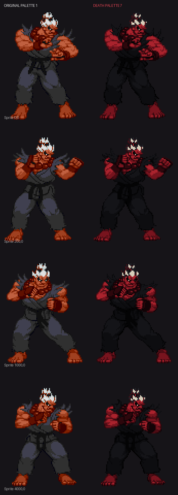

<div align="center">

# Street Fighter: Dark Ascension

### IKEMEN GO tabanlı karanlık Street Fighter fan projesi


**Klasik Street Fighter oynanışını karanlık karakter editleri, özel süperler,  
yenilenmiş komut listeleri ve kademeli Arcade yapısıyla birleştiren bağımsız fan çalışması.**

> An unofficial IKEMEN GO fan project featuring curated dark, evil, cyber and boss-style Street Fighter character edits.

</div>

---

## Proje hakkında

Street Fighter: Dark Ascension; farklı M.U.G.E.N yapımcılarının karakterlerini tek bir IKEMEN GO paketi altında düzenleyen, uyumluluk sorunlarını gideren ve karakterleri ortak bir oyun akışında buluşturan, ticari olmayan bir fan projesidir.

Projenin odağında yalnızca karakter toplamak değil; her karakteri IKEMEN GO üzerinde çalışır hâle getirmek, oyun içi hareket listesini tamamlamak, AI davranışlarını dengelemek ve Arcade ilerleyişini tutarlı bir deneyime dönüştürmek bulunur.

## Öne çıkan özellikler

- 24 seçilmiş ana karakter ve farklı oynanış stilleri
- Evil, Dark, Cyber, Divine ve boss temalı Street Fighter editleri
- IKEMEN GO oyun içi **Command List** desteği
- Karakterlere göre düzenlenmiş ve doğrulanmış hareket listeleri
- 1280×720 çözünürlük ve VSync desteği
- Klavye ve gamepad desteği
- Kademeli AI zorluğu
- 13 maçlık Arcade rotası
- Death Ogre için özel süper hareketler ve siyah-kırmızı **Death Palette**
- Eski WinMUGEN karakterleri için IKEMEN uyumluluk düzeltmeleri
- Karaktere özel denge ve AI düzenlemeleri

## Özel çalışma: Death Ogre

Death Ogre için mevcut paletlere ek olarak siyah kıyafet, kırmızı ten ve kırmızı enerji efektlerinden oluşan özel bir görünüm hazırlandı.

<p align="center">
  
</p>

Karakter ayrıca projeye özel komut varyasyonları, güçlendirilmiş saldırılar ve **Ogre Cataclysm** gibi yeni süper hareketler içerir.

## Arcade yapısı

Arcade Single toplam **13 maçtan** oluşur:

| Aşama | Maç | Açıklama |
|---|---:|---|
| Normal rakipler | 8 | Dengeli karakter havuzundan rastgele seçim |
| Güçlü rakipler | 4 | Daha gelişmiş ve saldırgan karakter editleri |
| Final boss | 1 | Boss havuzundan rastgele seçim |

Final boss havuzu:

- God Rugal
- Death Ogre
- Master God Ken
- Shin Gouki
- Shin Bison
- Evil Sagat

Mevcut varsayılan zorluk seviyesinde AI, Arcade boyunca kademeli olarak yükselir ve final karşılaşmasında en yüksek seviyesine ulaşır.

## Karakter kadrosu

### Normal grup

- Cyber Dan
- Shadow Lady Alpha
- Evil Dan
- Blaze
- Dark Sakura
- K-Sagat
- Charlie Nash
- Blanka QC
- Dhalsim

### Güçlü grup

- Evil Ken
- Evil Ryu
- Cyber Akuma
- Cyber Ryu
- Jin Kazama
- Cyber Ken
- Dictator
- Divine Sagat
- Mech Zangief

### Boss grubu

- God Rugal
- Death Ogre
- Master God Ken
- Shin Gouki
- Shin Bison
- Evil Sagat

Seçim ekranında ayrıca IKEMEN GO test karakterleri ve `Random Select` alanı bulunur.

## Kurulum ve çalıştırma

### Hazır sürüm

1. GitHub **Releases** bölümünden en güncel paketi indirin.
2. Arşivi yazma izniniz bulunan bir klasöre tamamen çıkartın.
3. `Ikemen_GO.exe` dosyasını çalıştırın.

Kurulum gerektirmez. Oyunu arşivin içinden çalıştırmayın; bütün dosyaların çıkartılmış olması gerekir.

### Kaynak depodan çalıştırma

GitHub sayfasındaki **Code → Download ZIP** seçeneğiyle depoyu indirin, arşivi çıkartın ve kök klasördeki `Ikemen_GO.exe` dosyasını çalıştırın.

Karakter ve ses dosyaları nedeniyle depo boyutu yüksektir. Son kullanıcılar için kaynak depoyu klonlamak yerine GitHub Releases paketinin kullanılması önerilir.

## Varsayılan kontroller

### Oyuncu 1

| İşlev | Tuş |
|---|---|
| Yönler | Ok tuşları |
| Hafif / Orta / Ağır yumruk | Q / W / E |
| Hafif / Orta / Ağır tekme | A / S / D |
| Start / Onay | Enter |

### Oyuncu 2

| İşlev | Tuş |
|---|---|
| Yönler | I / J / K / L |
| Hafif / Orta / Ağır yumruk | R / T / Y |
| Hafif / Orta / Ağır tekme | F / G / H |
| Start | Sağ Shift |

Kontroller oyun içindeki **Options → Input Settings** bölümünden değiştirilebilir. XInput uyumlu gamepad'ler desteklenir.

## Hareket listeleri

Desteklenen karakterlerin hareketleri IKEMEN GO'nun oyun içi komut listesine bağlanmıştır.

1. Bir karşılaşma başlatın.
2. Oyunu duraklatın.
3. **Command List** seçeneğini açın.
4. Karakterin özel hareketlerini, süperlerini ve enerji gereksinimlerini görüntüleyin.

Bazı karakterler palet seçimine veya özel dönüşümlere bağlı ek hareketlere sahiptir. Örneğin Dhalsim, maçta bir kez kullanılabilen dönüşümünden sonra ayrı bir hareket setine geçer.

## Proje yapısı

```text
MUGEN/
├── assets/       # Üretilen görseller ve çalışma dosyaları
├── chars/        # Karakterler ve hareket listeleri
├── data/         # Ekran paketi, roster ve dövüş sistemi ayarları
├── external/     # IKEMEN GO çalışma betikleri
├── font/         # Yazı tipleri
├── save/         # Kullanıcı ayarları ve kayıtlar
├── scripts/      # Projeye özel üretim/düzenleme araçları
├── sound/        # Ortak ses ve müzik dosyaları
├── stages/       # Arenalar
└── Ikemen_GO.exe
```

## Geliştirme durumu

Proje aktif olarak geliştirilmektedir. Planlanan çalışmalar:

- Daha fazla karanlık ve alternatif Street Fighter karakteri
- Yeni Honda ve Demon Dhalsim editleri
- Karakterler arası hasar ve AI dengelemesi
- Daha fazla sahne ve müzik
- Portre ve seçim ekranı iyileştirmeleri
- Ek görsel efekt ve palet çalışmaları
- Karakter bazlı Arcade rotaları ve özel boss karşılaşmaları

Hata bildirirken karakter adını, kullanılan hareketi ve mümkünse `save/logs` klasöründeki ilgili hata kaydını ekleyin.

## Karakter kredileri

Bu proje, farklı M.U.G.E.N topluluk yapımcılarının çalışmalarını içerir. Ana karakterlerin DEF dosyalarında belirtilen yapımcılar aşağıdadır:

| Karakter | Orijinal yapımcı / editör |
|---|---|
| Evil Ken | Reu |
| Evil Ryu | Reu & KingTigre |
| God Rugal | @ndroide |
| Death Ogre | JUN |
| Cyber Akuma | Scar |
| Cyber Dan | BlackJack |
| Shadow Lady Alpha | WhiteMagic2002, Ehnyd, SUPERFERNANDOXT |
| Cyber Ryu | Kenshiro99, Ramon Garcia, AVPboy6754 |
| Master God Ken | Karakter paketinde açık yapımcı bilgisi bulunmuyor |
| Evil Dan | ilcane87 |
| Jin Kazama | Infinite |
| Shin Gouki | Phantom.of.the.Server |
| Cyber Ken | Scar |
| Shin Bison | B.Skryo-Rextrion |
| Dictator | Dictador |
| Blaze | Zmugens & Laslab |
| Dark Sakura | varo_hades |
| Divine Sagat | DivineWolf |
| K-Sagat | Kamekaze |
| Mech Zangief | KoYotae & One Winged Angel |
| Evil Sagat | Greetlock |
| Charlie Nash | Trololo |
| Blanka QC | (^o^) |
| Dhalsim | 3ha |

Ek yapımcı ve kaynak bilgileri için her karakterin kendi klasöründeki README, metin ve DEF dosyalarını inceleyin. Bir kredi eksik veya hatalıysa düzeltilebilmesi için bildirim açabilirsiniz.

## Motor ve lisanslar

Proje [IKEMEN GO](https://ikemen-engine.github.io/) üzerinde çalışır. IKEMEN GO motoru MIT lisanslıdır; beraberindeki ekran paketi, yazı tipleri ve diğer bileşenler farklı lisanslara sahip olabilir. Ayrıntılar için [LICENSES.txt](LICENSES.txt) dosyasına bakın.

Karakterler, sprite'lar, sesler, müzikler ve Street Fighter ile ilişkili adlar kendi yapımcılarının ve hak sahiplerinin mülkiyetindedir. Bu depo:

- Capcom veya diğer hak sahipleri tarafından hazırlanmış ya da onaylanmış değildir.
- Ticari olmayan, bağımsız bir fan ve modifikasyon çalışmasıdır.
- İçerdiği üçüncü taraf çalışmalar üzerinde sahiplik iddiasında bulunmaz.
- Her karakterin orijinal kullanım ve yeniden dağıtım koşullarına tabidir.

Bir içeriğin kaldırılması veya kredi bilgisinin düzeltilmesi gerekiyorsa depo yöneticisiyle iletişime geçin.

---

<div align="center">

**Made with IKEMEN GO and the work of the M.U.G.E.N community.**

</div>
